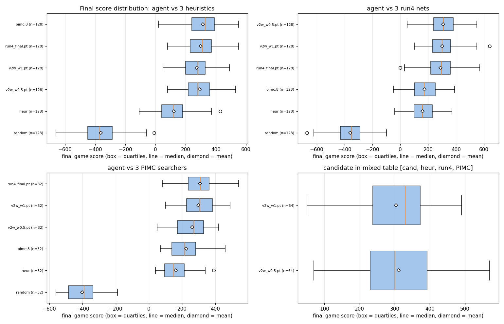
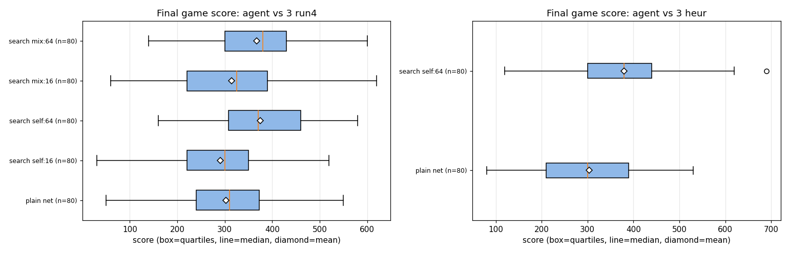
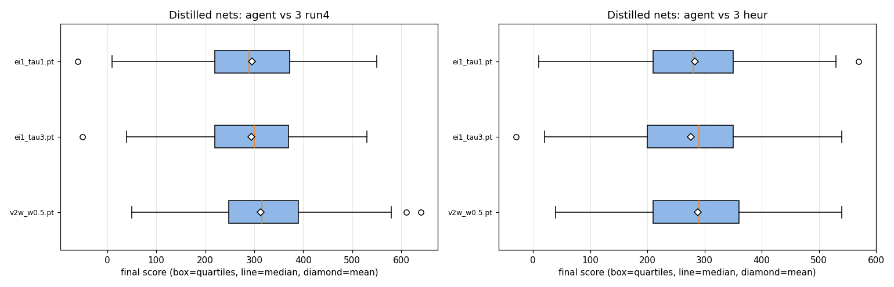

# Wizard AI - Progress

## Decisions
- 4 players, 15 rounds (60 cards). Dealer rotates; left of dealer bids/leads first.
- Trump = upcard suit; Wizard/Jester upcard -> random trump suit; round 15 has no trump.
- Dealer cannot bid so that total bids == number of tricks.
- Jester led: suit set by first non-Jester card; all-Jester trick goes to the first Jester.
- Scoring: made bid 20 + 10/trick; missed -10 per trick of difference.
- Stack: Python 3.11, PyTorch 2.0.1+cu117, RTX 3070 8GB, 16 CPU threads.
- Goal: superhuman. Path: engine -> heuristic -> PIMC search -> PPO self-play -> net+search.

## Layout
- `wizard/engine.py` rules; `wizard/agents.py` agents; `wizard/cli.py` console game (`python -m wizard.cli`)
- `eval/arena.py` seat-rotated evaluation (`python -m eval.arena 100`)
- `tests/` (`python -m pytest tests`)

## Log
### Phase 1-3 (done)
- Engine + 5 tests incl. 300-game random fuzz: pass.
- Baselines (mean score per game, 100 seeds x 4 seats, 95% CI):
  - Heuristic vs 3 Random: +159 +- 10
  - Random vs 3 Heuristic: -354 +- 12
  - Heuristic vs 3 Heuristic: +125 +- 10 (self-play reference)
- Note: heuristic is simple (bid from card strength, win/duck by bid need). Easy to improve; it is mainly a benchmark.

### Phase 4 (done): PIMC agent (wizard/pimc.py)
- Samples opponent hands consistent with played cards and inferred voids, rolls out each candidate bid/card with the heuristic, picks the best mean round score.
- PIMC (8 samples) vs 3 Heuristic: +295 +- 37 (48 games; heuristic self-play reference is +125). About 2.3 s/game, slow in pure Python.
- Weaknesses: optimizes own round score only, ignores opponent bids when sampling, rollouts use the weak heuristic.

### Phase 5 (in progress): PPO self-play (wizard/features.py, train/ppo.py)
- Python engine is fast enough (~1.3 s to collect 1024 rounds), so no vectorized engine yet.
- Episode = one round (random size 1-15). Reward = own round score / 50, no discount. 4 seats; 75% of seats played by the current net, 25% by heuristic (not trained on).
- Net: residual MLP (3 blocks, 512), one policy head over 60 cards + 16 bids with legal masking, plus a value head. Input: hand, played cards, trick, upcard, trump, bids/won/need by relative seat, inferred voids, round info.
- Run 1 (30 min, batch 1024 rounds): net (greedy) vs 3 heuristic, 24 games x 4 seats: -78 (it 10) -> +160 (it 170, ~6.5 min). Heuristic-vs-heuristic is +125, PIMC is +295. Run still going; checkpoint at checkpoints/ppo_latest.pt.
- Caveat: eval is only 96 games per point (CI about +-20), so small differences are noise.

### Phase 5 update: league PPO (run 3, 40 min, batch 2048)
- Added a league (last 8 snapshots every 15 its, 35% of seats; 15% heuristic seats), batched league inference (collect 40s -> 3.5s), LR decay.
- Net vs 3 heuristic: +205 +- 18 at the end (run 1 plateaued near +150). Checkpoint: checkpoints/run3_final.pt.
- Play it: `python -m wizard.cli --bots net net net` (choices: net, pimc, heuristic, random; optional --seed).

### Network architecture (wizard/features.py)
- Input 463 floats: own hand (60), all played cards (60), current trick by relative seat (4x60), upcard (60), trump one-hot (5), per relative seat [has-bid, bid, won, need] (16), dealer position (4), inferred voids of 3 opponents (12), round info (6).
- Body: Linear(463->512) + ReLU, then 3 residual blocks h = ReLU(h + Linear(ReLU(Linear(LayerNorm(h))))), width 512. 1.86M parameters.
- Heads: policy Linear(512->76) = 60 cards + 16 bids (illegal actions masked to -1e9; bid vs play is decided by game phase), value Linear(512->1) = predicted round score/50.
- No recurrence/attention: card memory is the played-card bitmap plus void flags.

### GUI (wizard/gui.py)
- Mouse-driven tkinter: `python -m wizard.gui --bots net net net [--ckpt checkpoints/run4.pt] [--speed 0.5]`. Scoreboard, table with the current trick, clickable hand (illegal cards greyed, trump tinted), bid buttons, log.
- Tested with an auto-clicking script through a full 15-round game, no errors.

### Run 4 (in progress): fine-tune from run3, 90 min, batch 4096, lr 1.5e-4 -> checkpoints/run4.pt (train/run4.log)
- train/ppo.py now takes: minutes batch [init_ckpt|none] [out_path] [lr].

### Phase 6 (first version): net-guided search (wizard/netsearch.py, eval/compare2.py)
- NetSearchAgent: samples hidden hands (void-aware) like PIMC, but rolls out each candidate bid/card with the run3 net playing all four seats, batched. 16 samples per decision.
- Paired comparison, same 30 deals x 4 seats (120 games each), focal agent vs 3 heuristics:
  - net (run3) 224.5 +- 16.6; PIMC (heuristic rollouts, 8 samples) 324.3 +- 15.9; net-search (16 samples) 313.6 +- 16.2.
  - paired PIMC - net = +99.8 +- 23.4; net-search - net = +89.1 +- 22.3. Net-search is NOT better than PIMC (difference is within noise).
- Cost: net-search is about 50 s/game (CPU, while training ran), PIMC a few s/game, net milliseconds.
- Bug found and fixed: torch.multinomial (torch 2.0) occasionally returned a masked/illegal action and crashed the eval; sampling now uses Gumbel-max (wizard/netsearch.py, wizard/features.py). train/ppo.py still uses Categorical.sample (no crash seen in training).
- Run 4 (fine-tune, still running at it 380): net vs 3 heuristic reached +271 +- 21 (run3 was +205), different seeds than the paired test above, so not directly comparable to PIMC's 324.

### Verified comparison (same 60 deals x 4 seats, 240 games each, vs 3 heuristics; eval/compare.py)
- heuristic 129 +- 12; net run3 216 +- 13; PIMC(8) 324 +- 13; paired PIMC - net = +109 +- 17.

### Run 4 (finished): fine-tune of run3, 90 min -> checkpoints/run4_final.pt, ~+265-275 vs 3 heuristics (v1 net, round-level reward = own score).

### Reward redesign (v2): zero-sum + final rank (decided with user)
- Concern: the net could cooperate with copies of itself (shared weights, positive-sum scoring, own-score reward, no game context).
- Collusion baseline on run4 (eval/collusion.py, 60 games): 4-run4 table gives 292 pts/player and 62.4% bid accuracy; the same net as one seat vs 3 heuristics gives 298 pts and 62.2%. No self-play score inflation. Gift-rate proxy is higher in the self-table (0.53 vs 0.37) but is confounded (see eval/collusion.md). Heuristic 122 pts / 51% bids; random -344 / 16%.
- v2 observation (wizard/features2.py): v1 features + running totals relative to me, own total, rounds left, number of players ahead, gap to leader (470 inputs). Same architecture otherwise.
- v2 training (train/ppo2.py): full 15-round games, reward per decision in round j = (own round score - mean of the others)/50 + W * (rank_reward(final) - rank_reward(totals before round j)). rank_reward = +1, +1/3, -1/3, -1 for 1st..4th (ties averaged). The subtracted term depends only on the visible state, so it lowers variance without biasing the gradient.
- Opponent seats in training: current net, 6 past snapshots, run4 net (permanent), heuristic (12%). No explicit anti-collusion term.
- Sweep over W in {0, 0.5, 1, 2}, 75 min each from scratch, 256 games per batch, run in parallel (train/v2_w*.log -> checkpoints/v2_w*.pt).
- Evaluation tooling: eval/harness.py (score, bid accuracy, win rate, rank, gift-rate), eval/report.py (tables vs 3 heuristics / 3 run4 / 3 PIMC / mixed table + score histograms PNG), eval/collusion.py.

### v2 sweep results (from scratch, 75 min each; eval/rep_v2sweep.md and eval/rep_v2sweep_hist.png (histogram version))
24 deals x 4 seats per cell. Score / bid accuracy / win rate / mean rank:

| agent | vs 3 heuristics | vs 3 run4 | vs 3 PIMC |
|---|---|---|---|
| heuristic | 117 / 50% / 25% / 2.50 | 155 / 53% / 3% / 3.48 | 162 / 55% / 9% / 3.12 |
| run4 (v1, own-score reward) | 303 / 63% / 74% / 1.31 | 278 / 61% / 25% / 2.50 | 307 / 65% / 61% / 1.72 |
| PIMC(8) | 311 / 65% / 78% / 1.35 | 173 / 51% / 4% / 3.30 | 225 / 57% / 25% / 2.50 |
| v2 W=0 | 202 / 52% / 53% / 1.79 | 207 / 53% / 8% / 3.12 | 221 / 54% / 19% / 2.44 |
| v2 W=0.5 | 188 / 50% / 47% / 1.85 | 200 / 52% / 7% / 3.17 | 197 / 52% / 20% / 2.84 |
| v2 W=1 | 178 / 49% / 37% / 2.00 | 188 / 50% / 10% / 3.23 | 195 / 52% / 14% / 2.88 |
| v2 W=2 | 155 / 48% / 37% / 2.14 | 140 / 46% / 5% / 3.50 | 128 / 45% / 6% / 3.05 |

- CORRECTION to the earlier summary: PIMC is only clearly ahead of the net when the opponents are heuristics (its rollouts model them exactly). Run4 is as good as PIMC vs heuristics (303 vs 311) and clearly beats PIMC head to head (vs 3 PIMC: run4 rank 1.72, win 61%; PIMC rank 2.50).
- From-scratch v2 nets are undertrained (about 220 iterations): above the heuristic but ~100 points below run4. Higher rank weight was worse at this budget (W=2 worst); W=0 best. This confounds the weighting question, so it needs re-testing at a comparable training level.
- Eval tooling note: eval.report left idle pool workers (about 3 GB) which caused Windows paging errors; harness now uses 8 workers.

### v2 warm-start sweep (finished): init = run4 weights, 7 new input columns zeroed (deviation from from-scratch decision), W in {0.5, 1}, 100 min, lr 1.5e-4
Report: eval/rep_v2warm.md, box plots eval/rep_v2warm_hist.png (32 deals x 4 seats; PIMC column 8 deals).

| agent | vs 3 heuristics (score / bid acc / win / rank) | vs 3 run4 | vs 3 PIMC |
|---|---|---|---|
| run4 | 299 / 62% / 74% / 1.34 | 288 / 62% / 25% / 2.50 | 307 / 65% / 61% / 1.72 |
| PIMC(8) | 315 / 66% / 81% / 1.31 | 173 / 52% / 4% / 3.33 | 225 / 57% / 25% / 2.50 |
| v2w W=0.5 | 291 / 62% / 75% / 1.36 | 308 / 65% / 34% / 2.27 | 260 / 60% / 41% / 2.11 |
| v2w W=1 | 272 / 60% / 73% / 1.34 | 301 / 63% / 26% / 2.37 | 298 / 63% / 59% / 1.62 |

(Box plots of final game scores. Box = quartiles, line = median, diamond = mean. Numbers in the table above came from an earlier run of the same evaluation; the box-plot run was re-sampled and may differ by about one CI. Raw scores: eval/rep_v2warm_raw.json.)

- Best overall: v2w W=0.5 (checkpoints/v2w_w0.5.pt). It beats run4 in a table of run4 copies (rank 2.27 vs 2.50 parity) and ties it elsewhere; differences are about one CI, so the gain is small. W=1 trades some score for similar rank. Rank weight is not a strong lever at this budget.
- Collusion check after retraining (eval/collusion.md, 60 tables of 4 copies): bid accuracy in the self-table equals bid accuracy vs 3 heuristics (run4 62.4/62.2, v2w0.5 61.5/62.3, v2w1 61.0/59.8); self-table pts/player (278-292) is not above the vs-heuristic score. Gift-rate proxy is no higher than run4's. No evidence of collusion.
- Play it: `python -m wizard.cli --bots net2 net2 net2` or `python -m wizard.gui --bots net2 net2 net2` ('net2' = v2w_w0.5).

### Status / plateau
- Strongest agents (run4, PIMC vs heuristics, v2w W=0.5) are within noise of each other against heuristics (~290-315, rank ~1.3). Gains from PPO fine-tuning have flattened: run4 -> v2w gave only a small edge in net-vs-net tables.
- Net-guided search (phase 6 v1) did not beat plain PIMC; it was tested only with the weak run3 net and vs heuristics.

### Expert iteration, step 1: does search over the v2w net beat the plain net? (wizard/netsearch2.py, eval/searcheval.py, eval/search1.log)
- NetSearch2: GPU-batched net-guided PIMC. For every candidate bid/card, sample hidden hands (void-aware), play the round out with the net in all 4 seats (sampled), average own round score. About 13 s/game at 8 samples (CPU shared).
- Paired, same 16 deals x 4 seats (64 games per cell), checkpoint v2w_w0.5:

| agent | vs 3 heuristics (score / bid acc / win / rank) | vs 3 run4 nets |
|---|---|---|
| plain net | 301 / 63.1% / 77% / 1.36 | 287 / 62.2% / 28% / 2.45 |
| search, 8 samples | 312 / 64.0% / 78% / 1.27 | 283 / 60.9% / 27% / 2.46 |
| search, 16 samples | 334 / 65.8% / 88% / 1.18 | 286 / 61.6% / 29% / 2.35 |

- Paired difference vs plain net: vs heuristics +11 +- 35 (8 samples), +33 +- 36 (16 samples); vs run4 nets -3 +- 32 and -1 +- 27. Not significant anywhere.
- Reading: there is a hint of a gain vs heuristics that grows with samples, but against run4 nets search adds nothing measurable. So there is no clearly stronger teacher yet; expert iteration's premise is not established.
### Expert iteration, step 1b: search with more samples (wizard/netsearch3.py, eval/searcheval2.py, eval/search2.log)
- Searcher = v2w_w0.5 net; 20 deals x 4 seats = 80 games per cell, same deals for every agent. 'self' rollouts: all opponents simulated as the same net. 'mix': each simulated opponent is randomly the v2 net or run4.

| agent | vs 3 run4 nets (score / bid acc / win / rank) | paired gain vs plain |
|---|---|---|
| plain net | 302 / 63.8% / 33% / 2.31 | - |
| search self, 16 samples | 291 / 61.8% / 29% / 2.37 | -11 +- 26 |
| search self, 64 samples | 375 / 70.8% / 51% / 1.74 | +72 +- 28 |
| search mix, 16 samples | 314 / 64.1% / 29% / 2.34 | +12 +- 29 |
| search mix, 64 samples | 368 / 70.1% / 57% / 1.76 | +65 +- 26 |

| agent | vs 3 heuristics | paired gain vs plain |
|---|---|---|
| plain net | 303 / 63.4% / 77% / 1.33 | - |
| search self, 64 samples | 379 / 70.2% / 91% / 1.11 | +76 +- 31 |

- Result: search needs enough samples. At 16 samples it adds nothing (as before); at 64 it is significantly better against both run4 nets and heuristics, with bid accuracy rising about 7 points. Mixing run4 into the opponent model made no measurable difference (368 vs 375), so the opponent model is not the bottleneck; sample count is.
- Cost: 64-sample search is roughly 4x slower than 16 samples (about a minute per game). So search is a real teacher: expert iteration's premise holds.
### Expert iteration, step 2: distil 64-sample search into the net (train/expert_gen.py, train/expert_train.py, eval/eieval.py)
- Data: 47,319 search decisions (4 workers, 150 min, 105 games per worker). One 64-sample searcher seat (v2w_w0.5 as rollout net) vs random mix of heuristic / run4 / v2w_w0.5 / v2w_w1; recorded obs, legal mask and the search's mean round score per option (data/ei1_w*.npz).
- Training: fine-tune v2w_w0.5 with cross-entropy to softmax(Q / tau), tau in {30, 10, 3, 1}. Validation top-1 agreement with the search stays at about 50% (the plain net already agreed 50% before training), so the labels are noisy or the net already near its ceiling on this data.
- Play results, 64 deals x 4 seats (256 games), paired vs the plain net v2w_w0.5 (score vs 3 run4 nets / vs 3 heuristics):

| net | vs 3 run4 | paired vs plain | vs 3 heuristics | paired vs plain |
|---|---|---|---|---|
| plain v2w_w0.5 | 313 | - | 288 | - |
| distilled tau=30 | 246 | -67 +- 16 | 243 | -45 +- 15 |
| distilled tau=10 | 281 | -33 +- 16 | 284 | -4 +- 16 |
| distilled tau=3 | 294 | -20 +- 15 | 276 | -12 +- 15 |
| distilled tau=1 | 295 | -18 +- 15 | 284 | -5 +- 15 |

- Result (negative): supervised distillation on this dataset does NOT improve the net; every variant is equal or worse, and the soft targets (high tau) hurt most. One round of 47k noisy labels is not enough, or the labels are too noisy (64 samples, stochastic rollouts), or imitating the argmax loses calibration that PPO had built.
- The search agent itself remains the strongest player (+65 to +76 over the plain net). It is now playable: `python -m wizard.cli --bots search net2 net` or `python -m wizard.gui --bots search net2 net` ('search' = 64-sample search over v2w_w0.5, uses the GPU, about a minute per game).

### Next ideas (not yet done)
- Use the search value rather than argmax imitation: train the value head on search/rollout outcomes, or use search as a PPO baseline; or make labels less noisy (more samples, common random numbers across options, more data) before retrying distillation.
- Larger / sequence model with explicit card memory.

### GUI rework and README
- GUI now uses Green/Yellow/Red/Blue instead of the card suits (engine suit order 0..3 = Green, Yellow, Red, Blue; engine SUITS = GYRB, cli names updated), a full-width trump banner in the trump colour with gold-bordered TRUMP cards, and a separate bid-sum banner (running total while bidding; OVER-BID / UNDER-BID by d once all bids are in). Tested with an auto-clicking script through a full game.
- README.md written: full description of rules, engine, agents, network, training, search, distillation, evaluation, results and limitations.

