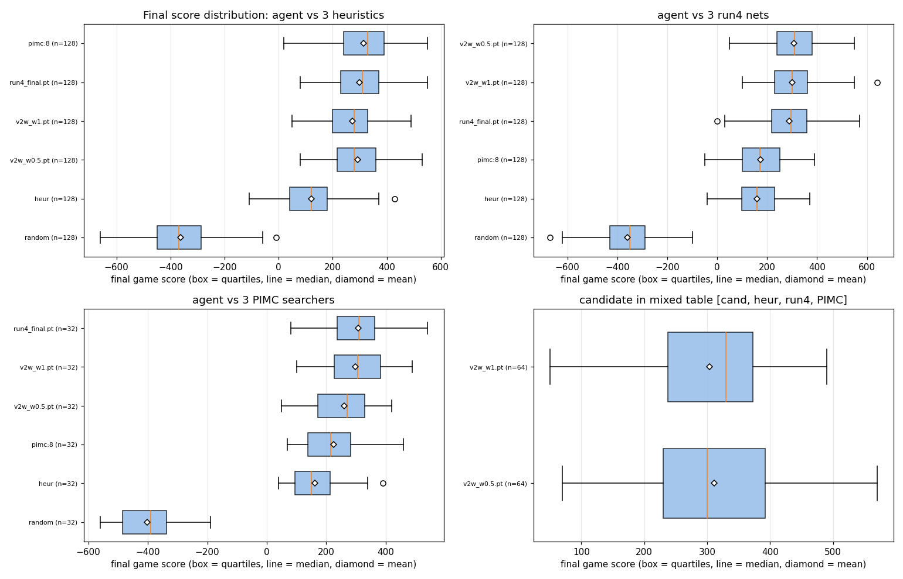
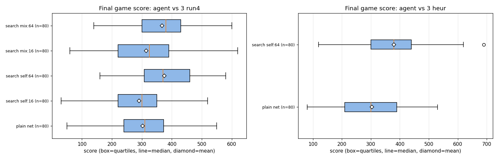

# Wizard: a 4-player card game and the AI agents that play it

A text, GUI and programmatic implementation of the trick-taking card game **Wizard**, plus a family of agents:
a heuristic baseline, a Monte-Carlo search agent, neural networks trained by self-play reinforcement learning, and a
network-guided search agent that is the strongest player here.

`PROGRESS.md` is the chronological lab notebook (every run, number and dead end). This file describes **what exists and
how it works**.

## Contents
1. [Quick start](#1-quick-start)
2. [Game rules as implemented](#2-game-rules-as-implemented)
3. [Project layout](#3-project-layout)
4. [Rules engine](#4-rules-engine)
5. [Agents](#5-agents)
6. [Neural network](#6-neural-network)
7. [Training](#7-training)
8. [Search on top of the network](#8-search-on-top-of-the-network)
9. [Expert iteration (distillation) attempt](#9-expert-iteration-distillation-attempt)
10. [Evaluation methodology](#10-evaluation-methodology)
11. [Results](#11-results)
12. [Collusion check](#12-collusion-check)
13. [Interfaces (GUI and console)](#13-interfaces-gui-and-console)
14. [Known limitations](#14-known-limitations)
15. [Reproducing everything](#15-reproducing-everything)

---

## 1. Quick start

Environment used: Windows, Python 3.11, PyTorch 2.0.1 (CUDA 11.7), NVIDIA RTX 3070 (8 GB), 16 logical CPUs.
Extra packages: `pytest`, `matplotlib`, `numpy`. The GUI uses `tkinter` (ships with Python).

```powershell
cd Documents\magic_man_2.0

# mouse-driven game: you (bottom seat) vs three bots
python -m wizard.gui --bots net2 net2 net2
python -m wizard.gui --bots search net2 net          # includes the strongest agent (slow, GPU)

# text game
python -m wizard.cli --bots net net net

# tests
python -m pytest tests
```

Bot names (`--bots A B C` for seats P1-P3):

| name | agent |
|---|---|
| `random` | uniformly random legal moves |
| `heuristic` | hand-written rules |
| `pimc` | Monte-Carlo search with heuristic rollouts (8 samples) |
| `net` | run-4 network (v1 observation) |
| `net2` | best v2 network (`checkpoints/v2w_w0.5.pt`) |
| `search` | 64-sample network-guided search over `v2w_w0.5` (strongest; about a minute per game on the GPU) |

Useful options: `--seed N` (repeatable deals), `--speed 0.5` (GUI, faster animation), `--ckpt FILE` (GUI, checkpoint for `net`).

---

## 2. Game rules as implemented

- **Exactly 4 players**, 15 rounds. Round *n* deals *n* cards to each player (so 15 rounds use all 60 cards).
- **Deck:** 52 suited cards (4 suits x ranks 2..A), 4 Wizards, 4 Jesters.
- **Suits are colours:** Green, Yellow, Red, Blue (engine suit indices 0..3).
- **Trump:** after dealing, the next card is the upcard and its suit is trump. If the upcard is a Wizard or a Jester,
  the trump suit is chosen **at random**. In round 15 all cards are dealt, so there is **no trump**.
- **Bidding:** the player left of the dealer bids first, the dealer bids last. Each player bids how many tricks they will
  win. **Dealer restriction:** the dealer may not bid a number that makes the total of all bids equal the number of tricks.
  (So the table is always over-bid or under-bid.)
- **Play:** the player left of the dealer leads trick 1; later tricks are led by the previous trick's winner.
  You must follow the led suit if you can. Wizards and Jesters can always be played.
- **Led suit:** the suit of the first non-Jester card played. A Wizard leading means no suit must be followed;
  a Jester leading defers the suit to the first non-Jester card.
- **Winning a trick:** the first Wizard played; else the highest trump; else the highest card of the led suit;
  if every card is a Jester, the first Jester.
- **Scoring per round:** bid made = 20 + 10 per trick won. Bid missed = -10 per trick of difference (over or under).
- **Dealer rotates** each round.

---

## 3. Project layout

```
wizard/
  engine.py      rules engine (Round, Game, View, play_game); no I/O, seedable
  agents.py      RandomAgent, HeuristicAgent
  pimc.py        PIMCAgent + hidden-hand sampling + void inference
  features.py    v1 observation encoder, Net (policy/value), NetAgent
  features2.py   v2 observation (adds game context), loader, Agent2
  netsearch.py   (early) search with the v1/run3 net
  netsearch2.py  (intermediate) GPU-batched search over a v2 net
  netsearch3.py  final search agent: GPU-batched, optional opponent-model mixture
  cli.py         console game (full-name cards, scoreboard, bid-sum info)
  gui.py         tkinter mouse GUI
train/
  ppo.py         v1 PPO (round-level episodes, own-score reward)
  ppo2.py        v2 PPO (full games, zero-sum + final-rank reward, league)
  expert_gen.py  search-labelled data generation
  expert_train.py  distillation trainer
eval/
  harness.py     game runner, metrics, parallel evaluation helpers
  report.py      full report: tables + box plots
  collusion.py   collusion check
  searcheval*.py, eieval.py, compare*.py, arena.py   specific experiments
  *.md, *.png, *.json   saved results
tests/test_engine.py     rule tests + random-play fuzz
checkpoints/             network weights
data/                    search-labelled training data (npz)
goals.txt                original task and saved design decisions
PROGRESS.md              chronological log
```

---

## 4. Rules engine

`wizard/engine.py`

- **Cards** are integers 0..59: `0..51` suited (`suit = c // 13`, `rank = c % 13`, 0 = "2", 12 = Ace),
  `52..55` Wizards, `56..59` Jesters.
- **`Round(n, dealer, rng)`** holds one deal: hands (sets), upcard, trump, bids (in bidding order), tricks won, the
  current trick, completed tricks, and the game totals before this round. Phases: `bid`, `play`, `done`.
  Methods: `legal_bids()`, `bid()`, `legal_cards()`, `play()`, `scores()`, `clone()` (used by search).
- **`Game`** runs 15 rounds, rotates the dealer and accumulates totals.
- **`View`** is the information a single player is allowed to see (own hand, bids, tricks won, played cards, trump,
  totals; never other hands). Agents receive a `View`.
- **`play_game(agents, seed)`** plays a full game given four agents exposing `bid(view)` and `play(view)`.
- Illegal moves raise `AssertionError`, so a buggy agent cannot cheat silently.
- **Tests** (`tests/test_engine.py`): trick-winner cases (Wizard, trump, Jester leads), follow-suit rules including Wizard and
  Jester leads, the dealer bid restriction, no-trump round 15, and a 300-game fuzz with random agents.

---

## 5. Agents

### Random (`agents.py`)
Uniform over legal bids / cards. Reference floor.

### Heuristic (`agents.py`)
- **Bid:** estimate tricks as a sum of per-card values (Wizard 1.0; high trumps up to about 1; Aces about 0.55, Kings about 0.3, Queens about 0.12 off-trump), scaled down in long hands; pick the nearest legal bid.
- **Play:** let `need = bid - tricks won`. If tricks are still needed, win as cheaply as possible (or dump the weakest card if it cannot win). If on or over target, avoid winning by shedding the highest card that still loses; take the cheapest winner only if forced.

### PIMC (`pimc.py`)
Perfect-Information Monte Carlo. For every candidate bid/card: sample hidden opponent hands consistent with cards seen and
inferred **voids** (a player who failed to follow a suit lacks it); play the round out with the heuristic in all seats;
average own round score; choose the best. 8 samples, pure Python. Optimises only the current round.

### Neural agents (`features.py`, `features2.py`)
Play the argmax of the policy head over legal actions. See section 6.

### Network-guided search (`netsearch3.py`)
Same procedure as PIMC but rollouts are played by the neural network in all seats, batched on the GPU, with 64 samples
per decision. See section 8.

---

## 6. Neural network

One network for bidding and playing. Defined in `wizard/features.py`; about 1.86 M parameters.

**Observation (v1, 463 floats)**, all from the acting player's point of view with seats expressed relative to "me":

| block | size | content |
|---|---|---|
| own hand | 60 | 1 per card held |
| cards played this round | 60 | all completed-trick cards |
| current trick | 4 x 60 | card played by each relative seat |
| upcard | 60 | one-hot |
| trump suit | 5 | four suits + none |
| per seat bid state | 16 | has-bid, bid/15, won/15, (bid - won)/15 for each of 4 seats |
| dealer | 4 | relative position one-hot |
| inferred voids | 12 | suit-void flags for the 3 opponents |
| round info | 6 | n/15, tricks played, tricks left, sum of bids/15, bidding-phase flag, cards in trick |

**v2 observation (470 floats, `features2.py`)** appends 7 game-context inputs: each opponent's running total minus mine
(/300, clipped), my total, rounds remaining, share of players ahead of me, and gap to the leader. This lets the net play
the 15-round game (protect a lead, chase a deficit) instead of single rounds.

**Architecture**
```
Linear(obs -> 512) + ReLU
3 x residual block:  h = ReLU(h + Linear(ReLU(Linear(LayerNorm(h)))))      width 512
policy head: Linear(512 -> 76)  = 60 card actions + 16 bid actions (0..15)
value head : Linear(512 -> 1)
```
Illegal actions are masked to -1e9 before the softmax. Whether an action is a bid or a card is decided by the game phase.
There is no recurrence or attention: card memory is carried by the played-card bitmap and the void flags.

---

## 7. Training

All training is self-play with PPO on the GPU (`train/`). The Python engine plus batched network inference generates several hundred
rounds per second per process, so no separate vectorised engine was needed.

### v1 (`train/ppo.py`): rounds, own-score reward
- Episode = one round of random size 1..15, reward = own round score / 50, no discount.
- Seats: the current net (75% in run 1; about 50% once the league was added), a **league** of the last 8 snapshots (every 15 iterations), and the heuristic (15%; not trained on).
- Advantage = reward - value; PPO clip 0.2, entropy bonus 0.01, 4 epochs, Adam, learning rate decayed linearly.
- Progress: run 1 plateaued at about +150 vs 3 heuristics; with a league and batching, run 3 reached about +205; run 4 (fine-tune, 90 min, batch 4096) reached about +270-300. `run4_final.pt` is the strongest v1 net.

### v2 (`train/ppo2.py`): full games, zero-sum + rank reward
Motivation: with own-score reward, shared weights and positive-sum scoring, copies of the net could drift into mutually helpful play,
and a score-only reward does not teach winning. So:
- **Observation** includes game context (section 6).
- **Episode** = a full 15-round game.
- **Reward per decision in round j** = (own round score - mean of the other three) / 50 + W x (rank_reward(final rank) - rank_reward(rank after the previous rounds)), where rank_reward = +1, +1/3, -1/3, -1 for 1st to 4th (ties averaged). The subtracted term depends only on visible state, so it lowers variance without biasing the gradient.
- **Opponent seats:** current net, last 6 snapshots, the run-4 net as a permanent league member, heuristic (12%).
- **Sweep over W** in {0, 0.5, 1, 2}.
  - From scratch (75 min each, run in parallel) all nets were undertrained, about 100 points below run 4; larger W was worse.
  - Warm start (run-4 weights, new input columns zeroed, 100 min, lr 1.5e-4) was the practical fix. `v2w_w0.5` and `v2w_w1` matched or slightly beat run 4 in net-vs-net tables. **`v2w_w0.5` is the best plain net.**
  - The warm start deviates from the original "retrain from scratch" decision; the from-scratch checkpoints are kept (`v2_w*.pt`).

---

## 8. Search on top of the network

`wizard/netsearch3.py` (earlier versions: `netsearch.py`, `netsearch2.py`).

For each non-trivial decision (more than one legal option):
1. Draw N (=64) hidden-hand assignments consistent with seen cards and inferred voids.
2. For every candidate bid/card, clone the round, apply it, and play the round to the end with the net sampling (Gumbel-max)
   in **all** seats. All simulations (N x options) advance together in GPU batches.
3. Pick the option with the highest mean own round score.

Optional `mix` mode: each simulated opponent is randomly the v2 net or the run-4 net (an opponent-model mixture). It made no measurable difference.

Findings: 16 samples gave nothing over the plain net; **64 samples gave a clear gain** (about +65 to +76 points vs run-4 nets or heuristics,
bid accuracy 64% -> 71%). Cost: about a minute per game versus milliseconds for the plain net. (`torch.multinomial` in torch 2.0 occasionally returned a masked
action, so sampling uses Gumbel-max instead.)

---

## 9. Expert iteration (distillation) attempt

Goal: make the fast net inherit the search's strength.
- `train/expert_gen.py`: 4 workers, 150 min, 64-sample searcher in one seat against a mix of heuristic / run-4 / v2 nets; saved observation, legal mask and the search's mean score per option. 47,319 decisions in `data/ei1_w*.npz`.
- `train/expert_train.py`: fine-tune `v2w_w0.5` with cross-entropy against softmax(Q / tau), tau in {30, 10, 3, 1}.
- **Result: negative.** Every distilled net was equal or worse than the plain net (down to -67 points at tau = 30). Top-1 agreement with the search stayed at about 50% (already 50% before training), which points to noisy labels (64 stochastic samples) and too little data. Not pursued further. Untried ideas: common random numbers across options, more samples and data, using search values to train the value head, or search as a PPO baseline.

---

## 10. Evaluation methodology

`eval/harness.py`
- **Paired design:** each agent plays the same deals in all 4 seat rotations, so differences are measured on identical card distributions. Paired differences carry 95% intervals.
- **Opponent sets:** 3 heuristics, 3 run-4 nets, 3 PIMC searchers, and a mixed table [candidate, heuristic, run-4, PIMC].
- **Metrics:** mean final score (with 95% CI), **bid accuracy** (% of rounds where tricks won = bid), **win rate** (finishing first; ties split), **mean rank**.
- **Collusion indicators** (section 12): four-copy table score and bid accuracy against the same net versus heuristics, and a "gift rate" proxy.
- **Reports:** `python -m eval.report NAME N_DEALS agent...` writes `eval/NAME.md`, a box-plot figure (box = quartiles, line = median, diamond = mean), and raw scores in JSON.
- Agent spec strings: `heur`, `random`, `pimc:8`, `net1:<ckpt>`, `net2:<ckpt>`, `ns2:<ckpt>:<samples>`, `ns3:<ckpt>|<self|mix>:<samples>`.

Caveat: a deal sample of 16 to 64 deals gives a margin of about +-13 to +-30 points, so differences under about 20 points are noise.

---

## 11. Results

Mean final score over 15 rounds against three opponents of the same type (seat-rotated, paired deals).
Bid accuracy in brackets where measured. Different tables used different deal samples, so only compare within a row group.

| agent | vs 3 heuristics | vs 3 run-4 nets |
|---|---|---|
| random | -363 (15%) | -359 |
| heuristic | 121 (50%) | 160 |
| PIMC, 8 samples | 315 (66%) | 173 |
| run 4 (v1) | 299 (62%) | 288 |
| v2w W=0.5 (best plain net) | 291 (62%) | 308 |
| v2w W=1 | 272 (60%) | 301 |
| search over v2w, 64 samples | 379 (70%) | 375 (71%) |

Search vs plain net on the same 80 games per cell: +72 +- 28 vs run-4 nets, +76 +- 31 vs heuristics.
Win rate vs 3 heuristics: heuristic 25% (parity), plain nets about 75%, search 91%.
Against 3 run-4 nets the plain v2w net wins about 34% of games, and the 64-sample search about 51-57% (parity is 25%).

Figures: `eval/rep_v2warm_hist.png`, `eval/search2_box.png`, `eval/ei1_box.png` (box plots of final scores).




Takeaways
- Plain nets reach about 2.4x the heuristic's score and win about three quarters of games against heuristics.
- PIMC is strong only against the heuristic it models; it is weak against nets (173 vs run-4 nets).
- 64-sample network-guided search is the strongest agent. Distillation did not transfer that strength to the plain net.
- No agent has been tested against human players.

---

## 12. Collusion check

Concern: shared-weight copies of a net might learn to help each other. Check (`eval/collusion.py`, results in `eval/collusion.md`,
60 tables): a table of four copies of one net versus the same net as a single seat against three heuristics.

| agent | 4-copy mean pts/player | 4-copy bid acc | one seat vs 3 heuristics, bid acc |
|---|---|---|---|
| heuristic | 122 | 50.9% | 50.3% |
| run 4 | 292 | 62.4% | 62.2% |
| v2w W=0.5 | 278 | 61.5% | 62.3% |
| v2w W=1 | 282 | 61.0% | 59.8% |

If copies were colluding, bid accuracy and points in the four-copy tables would exceed those against independent opponents. They do not.
The "gift rate" proxy (last player had a trick-winning card while needing tricks, declined, and the trick went to another needy player) is no higher for the v2 nets than for run 4;
it is noisy, since declining can be legitimate. No explicit anti-collusion term is used; the zero-sum reward and the rank term remove the incentive.

---

## 13. Interfaces (GUI and console)

**GUI (`wizard/gui.py`, tkinter).** You are the bottom seat.
- **Suit colours:** Green, Yellow, Red, Blue. Each card is filled with its suit colour and labelled with rank and colour name. Wizards are purple, Jesters grey.
- **Trump banner:** a full-width bar filled with the trump colour and the text "TRUMP SUIT: ...". It is grey when the round has no trump.
  Trump cards in your hand carry a **gold border** and a "TRUMP" label; trump cards on the table get the gold border too.
- **Bid-sum banner:** while bidding it shows the running total and how many players have bid. Once all four have bid it shows
  "OVER-BID by d" (orange: more bids than tricks) or "UNDER-BID by d" (blue: fewer bids than tricks).
- **Scoreboard:** bid, tricks won, tricks still needed (+ means more to win), cards left and game total per player.
- **Table:** the current trick in front of each seat; a log on the right.
- **Controls:** click a bid number (forbidden dealer bid is greyed out), then click a card. Illegal cards are greyed out; a hint states the led suit.
- Pacing is controlled by `--speed`.

**Console (`wizard/cli.py`).** Verbose text: full card names ("10 of Red"), hand grouped by suit, scoreboard each trick, legal-card list, trick winners, end-of-round tables.

---

## 14. Known limitations

- Single evaluation machine, modest deal samples (margins +-13 to +-30), so small differences are not resolved.
- Only 4-player Wizard with the stated rule variants; the network is tied to that card layout.
- The net has no recurrent memory; long-range card counting is limited to the played-card bitmap and void flags.
- Search assumes the opponents play like the net (the mixture test showed this does not matter much); each search decision is expensive and not suitable for fast play.
- Expert iteration was tried once and failed; the strong agent remains a slow search.
- Evaluation is against heuristics, nets and PIMC only; human strength is unmeasured.
- The Windows tool environment occasionally reported errors when launching background jobs even though they ran; a run of the report with 12 workers left idle processes that caused paging-file errors, so the harness now uses 8.

---

## 15. Reproducing everything

```powershell
# tests
python -m pytest tests

# v1 PPO: minutes batch [init|none] [out] [lr]
python -m train.ppo 40 2048
python -m train.ppo 90 4096 checkpoints/run3_final.pt checkpoints/run4.pt 1.5e-4

# v2 PPO: name minutes W [batch_games] [lr] [init]
python -m train.ppo2 v2_w0.5 75 0.5 256
python -m train.ppo2 v2w_w0.5 100 0.5 256 1.5e-4 checkpoints/v2_init_from_run4.pt

# evaluation report (box plots + tables), then collusion check
python -m eval.report rep_new 32 net2:checkpoints/v2w_w0.5.pt
python -m eval.collusion 60 heur net1:checkpoints/run4_final.pt net2:checkpoints/v2w_w0.5.pt

# search evaluation and expert iteration
python -m eval.searcheval2 20 4
python -m train.expert_gen data/ei1 150 4 64
python -m train.expert_train checkpoints/ei1_tau3.pt checkpoints/v2w_w0.5.pt 3 6 "data/ei1_w*.npz"
```
Run long jobs one at a time or limit workers: several simultaneous GPU/CPU jobs slow each other down considerably.

