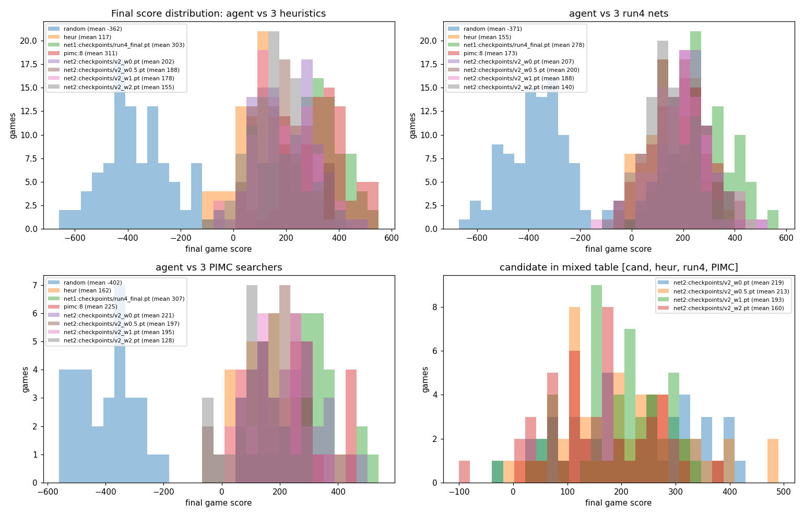

# Evaluation report (rep_v2sweep)

24 deals x 4 seat rotations per cell (same deals for every agent). Win rate = share of games finishing first (ties split). Bid accuracy = % of rounds where tricks won == bid.

## vs 3 heuristics

| agent | games | mean score | bid accuracy | win rate | mean rank |
|---|---|---|---|---|---|
| random | 96 | -362 +- 26 | 15.3% | 0.0% | 3.99 |
| heur | 96 | 117 +- 21 | 49.7% | 25.0% | 2.50 |
| net1:checkpoints/run4_final.pt | 96 | 303 +- 21 | 62.6% | 74.0% | 1.31 |
| pimc:8 | 96 | 311 +- 24 | 65.4% | 78.1% | 1.35 |
| net2:checkpoints/v2_w0.pt | 96 | 202 +- 22 | 52.2% | 53.1% | 1.79 |
| net2:checkpoints/v2_w0.5.pt | 96 | 188 +- 19 | 50.1% | 47.4% | 1.85 |
| net2:checkpoints/v2_w1.pt | 96 | 178 +- 20 | 49.2% | 37.3% | 2.00 |
| net2:checkpoints/v2_w2.pt | 96 | 155 +- 20 | 47.6% | 37.0% | 2.14 |

## vs 3 run4 nets

| agent | games | mean score | bid accuracy | win rate | mean rank |
|---|---|---|---|---|---|
| random | 96 | -371 +- 22 | 13.6% | 0.0% | 4.00 |
| heur | 96 | 155 +- 20 | 52.9% | 3.1% | 3.48 |
| net1:checkpoints/run4_final.pt | 96 | 278 +- 23 | 60.9% | 25.0% | 2.50 |
| pimc:8 | 96 | 173 +- 21 | 51.3% | 4.2% | 3.30 |
| net2:checkpoints/v2_w0.pt | 96 | 207 +- 20 | 52.7% | 7.6% | 3.12 |
| net2:checkpoints/v2_w0.5.pt | 96 | 200 +- 19 | 51.7% | 6.8% | 3.17 |
| net2:checkpoints/v2_w1.pt | 96 | 188 +- 23 | 50.3% | 10.4% | 3.23 |
| net2:checkpoints/v2_w2.pt | 96 | 140 +- 19 | 46.1% | 5.2% | 3.50 |

## vs 3 PIMC searchers

| agent | games | mean score | bid accuracy | win rate | mean rank |
|---|---|---|---|---|---|
| random | 32 | -402 +- 34 | 13.3% | 0.0% | 4.00 |
| heur | 32 | 162 +- 32 | 54.6% | 9.4% | 3.12 |
| net1:checkpoints/run4_final.pt | 32 | 307 +- 36 | 64.8% | 60.9% | 1.72 |
| pimc:8 | 32 | 225 +- 38 | 56.5% | 25.0% | 2.50 |
| net2:checkpoints/v2_w0.pt | 32 | 221 +- 36 | 54.2% | 18.8% | 2.44 |
| net2:checkpoints/v2_w0.5.pt | 32 | 197 +- 38 | 52.1% | 20.3% | 2.84 |
| net2:checkpoints/v2_w1.pt | 32 | 195 +- 35 | 51.5% | 14.1% | 2.88 |
| net2:checkpoints/v2_w2.pt | 32 | 128 +- 33 | 45.0% | 6.2% | 3.05 |

## Mixed table: agent vs [heuristic, run4, PIMC] (one seat each; focal replaces the matching seat by playing its own role)

| agent | games | mean score | bid accuracy | win rate | mean rank |
|---|---|---|---|---|---|
| net2:checkpoints/v2_w0.pt | 48 | 219 +- 32 | 54.0% | 29.2% | 2.36 |
| &nbsp;&nbsp;(opp) heur | 48 | 137 +- 29 | 52.6% | 6.2% | 3.11 |
| &nbsp;&nbsp;(opp) net1:checkpoints/run4_final.pt | 48 | 275 +- 31 | 60.1% | 51.0% | 1.82 |
| &nbsp;&nbsp;(opp) pimc:8 | 48 | 194 +- 30 | 54.4% | 13.5% | 2.70 |
| net2:checkpoints/v2_w0.5.pt | 48 | 213 +- 32 | 52.4% | 16.7% | 2.76 |
| &nbsp;&nbsp;(opp) heur | 48 | 144 +- 25 | 52.2% | 6.2% | 3.22 |
| &nbsp;&nbsp;(opp) net1:checkpoints/run4_final.pt | 48 | 287 +- 23 | 61.5% | 51.0% | 1.74 |
| &nbsp;&nbsp;(opp) pimc:8 | 48 | 249 +- 28 | 59.9% | 26.0% | 2.28 |
| net2:checkpoints/v2_w1.pt | 48 | 193 +- 24 | 51.1% | 6.2% | 2.79 |
| &nbsp;&nbsp;(opp) heur | 48 | 149 +- 25 | 53.3% | 12.5% | 3.15 |
| &nbsp;&nbsp;(opp) net1:checkpoints/run4_final.pt | 48 | 296 +- 25 | 62.5% | 66.7% | 1.50 |
| &nbsp;&nbsp;(opp) pimc:8 | 48 | 220 +- 29 | 56.9% | 14.6% | 2.56 |
| net2:checkpoints/v2_w2.pt | 48 | 160 +- 26 | 48.2% | 10.4% | 2.93 |
| &nbsp;&nbsp;(opp) heur | 48 | 136 +- 24 | 51.7% | 3.1% | 3.29 |
| &nbsp;&nbsp;(opp) net1:checkpoints/run4_final.pt | 48 | 310 +- 23 | 63.7% | 59.4% | 1.46 |
| &nbsp;&nbsp;(opp) pimc:8 | 48 | 218 +- 30 | 56.2% | 27.1% | 2.32 |

