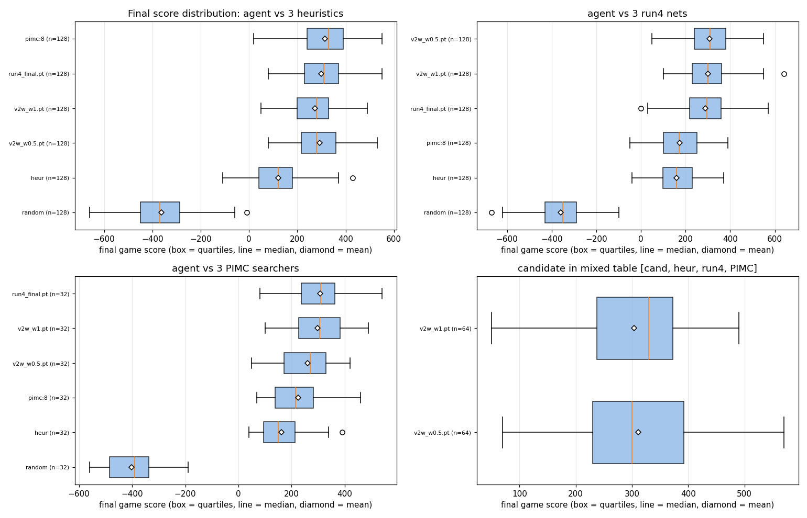

# Evaluation report (rep_v2warm)

32 deals x 4 seat rotations per cell (same deals for every agent). Win rate = share of games finishing first (ties split). Bid accuracy = % of rounds where tricks won == bid.

## vs 3 heuristics

| agent | games | mean score | bid accuracy | win rate | mean rank |
|---|---|---|---|---|---|
| random | 128 | -363 +- 21 | 15.3% | 0.0% | 3.99 |
| heur | 128 | 121 +- 19 | 50.5% | 25.0% | 2.50 |
| net1:checkpoints/run4_final.pt | 128 | 299 +- 18 | 62.2% | 74.2% | 1.34 |
| pimc:8 | 128 | 315 +- 19 | 66.0% | 80.5% | 1.31 |
| net2:checkpoints/v2w_w0.5.pt | 128 | 291 +- 18 | 62.1% | 75.4% | 1.36 |
| net2:checkpoints/v2w_w1.pt | 128 | 272 +- 17 | 59.6% | 73.0% | 1.34 |

## vs 3 run4 nets

| agent | games | mean score | bid accuracy | win rate | mean rank |
|---|---|---|---|---|---|
| random | 128 | -359 +- 19 | 14.6% | 0.0% | 4.00 |
| heur | 128 | 160 +- 16 | 53.7% | 3.1% | 3.47 |
| net1:checkpoints/run4_final.pt | 128 | 288 +- 20 | 62.1% | 25.0% | 2.50 |
| pimc:8 | 128 | 173 +- 17 | 51.5% | 4.3% | 3.33 |
| net2:checkpoints/v2w_w0.5.pt | 128 | 308 +- 18 | 64.5% | 34.4% | 2.27 |
| net2:checkpoints/v2w_w1.pt | 128 | 301 +- 18 | 63.0% | 25.8% | 2.37 |

## vs 3 PIMC searchers

| agent | games | mean score | bid accuracy | win rate | mean rank |
|---|---|---|---|---|---|
| random | 32 | -402 +- 34 | 13.3% | 0.0% | 4.00 |
| heur | 32 | 162 +- 32 | 54.6% | 9.4% | 3.12 |
| net1:checkpoints/run4_final.pt | 32 | 307 +- 36 | 64.8% | 60.9% | 1.72 |
| pimc:8 | 32 | 225 +- 38 | 56.5% | 25.0% | 2.50 |
| net2:checkpoints/v2w_w0.5.pt | 32 | 260 +- 35 | 60.2% | 40.6% | 2.11 |
| net2:checkpoints/v2w_w1.pt | 32 | 298 +- 34 | 63.3% | 59.4% | 1.62 |

## Mixed table: agent vs [heuristic, run4, PIMC] (one seat each; focal replaces the matching seat by playing its own role)

| agent | games | mean score | bid accuracy | win rate | mean rank |
|---|---|---|---|---|---|
| net2:checkpoints/v2w_w0.5.pt | 64 | 311 +- 27 | 64.1% | 41.4% | 1.88 |
| &nbsp;&nbsp;(opp) heur | 64 | 144 +- 23 | 51.5% | 5.5% | 3.36 |
| &nbsp;&nbsp;(opp) net1:checkpoints/run4_final.pt | 64 | 292 +- 26 | 62.3% | 36.7% | 2.10 |
| &nbsp;&nbsp;(opp) pimc:8 | 64 | 236 +- 25 | 57.8% | 16.4% | 2.66 |
| net2:checkpoints/v2w_w1.pt | 64 | 304 +- 26 | 63.4% | 43.8% | 1.88 |
| &nbsp;&nbsp;(opp) heur | 64 | 123 +- 25 | 49.2% | 3.9% | 3.43 |
| &nbsp;&nbsp;(opp) net1:checkpoints/run4_final.pt | 64 | 285 +- 25 | 61.3% | 41.4% | 1.98 |
| &nbsp;&nbsp;(opp) pimc:8 | 64 | 210 +- 20 | 56.0% | 10.9% | 2.71 |

